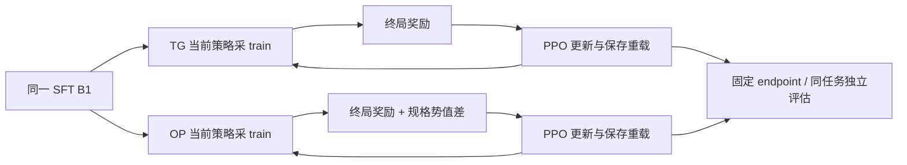

# 给 Yuxiao 的 pre 内容交接：11/26，约 5 分钟

版本：2026-11-21，基于已合并 #29/#30 与六轮工程证据。本文是内容与讲稿交接，不是已制作的 PPTX。原始数据、未来主实验、证据验收三个层次必须区分。角色/日期见 [TEAM](../docs/TEAM.md)，方案见 [执行协议](../docs/RL_EXECUTION_PROTOCOL_20261121.md)。

## 五页结构与时间

| 页 | 时间 | 要讲的结论 | 素材 / 负责人 |
|---|---:|---|---|
| 1 任务与问题 | 35秒 | 给定购物需求，多轮搜索/点击，购买不等于买对；研究规则奖励塑形是否影响有限预算学习 | 一个真实购物任务截图或脱敏轨迹，How供、Zqqq核；标注来源，不造案例 |
| 2 系统与数据 | 55秒 | 同一SFT起点、真实采样/更新/重载、新采样；train/val/test隔离 | 下方闭环图；1451/160对话、200保留test任务、排除13；Jun/Qiu核 |
| 3 两种奖励 | 80秒 | TG终局得分 vs OP规格势值差；初始/终止势值为0时总分守恒；规则不是学习型进度模型 | 两条公式、循环例、失败估计器诊断；Zqqq核方法 |
| 4 证据与结果 | 85秒 | 六轮工程闭环已核记录；小样本未显示满分成功提升；主实验与结果必须按实际更新 | 下方结果卡、终版160任务表占位，Qiu核每一数字 |
| 5 范围、限制与结论 | 45秒 | 16次更新/64episode是有限预算；两种子、规则词面限制、负结果；不称神经SPA复现 | 贡献/限制/复现入口，各人核本人部分 |

总计300秒，含页间过渡；是否另算Q&A未核实。11/24做第一次限时排练，11/25 18:00前冻结讲稿/图表/离线演示，全组再练；11/26展示。若课程规定不同时间/语言，按官方要求调整。

## 可以直接使用的闭环图

## 第3页公式与循环示例

TG：r_t = 末步的 R；未购买结束 R=0，页面分不替代R。

OP：r_t = TG奖励 + Phi(s_next) − Phi(s_current)。两臂beta/KL均为0。

教学示例（不是实际模型得分）：选择匹配规格使Phi从0变0.2，得到+0.2；撤销回到0得到−0.2；往返净增益0。购买终止强制下一Phi=0，避免保留终点势值制造额外总奖励。gamma=1是本协议条件，不能不改公式就推广到任意折扣。

**不能讲**：“每个合法动作都加分”“OP预测了每步真实贡献”“势函数守恒所以必然提升”。原学习型估计器独立复验未超过简单基线，作为负结果而非正式奖励模型。

## 第4页目前能引用的结果卡

| 结果层级 | 数字 | 使用边界 |
|---|---|---|
| 历史4-bit SFT验证，n=160 | B0满分19/160，原SFT50/160；购买57→158，终局均分0.2389→0.7059 | 这是SFT变化，不是RL结果；与新FP32评估不能混表比较 |
| 三轮工程短跑 | 两臂各3更新/14决策/14实际step/794token，记录一致性已复核 | 证明工程记录可追踪，不独立证明每个网页得分或状态恢复逐元素等价 |
| 同批FP32八任务 | TG/OP均购买8/8、满分5/8、均分0.7125、非法1/29 | 两臂逐项持平；不由n=8推出等价或总体提升 |
| 新同批原SFT基线 | How反馈购买7/8、满分5/8、均分0.6708、非法8/37 | 新运行原件仍需共享复算，图注必须标执行方反馈；runner哈希一致不等于结果已独立验收 |
| 预定主实验 | seeds42/43；每臂每种子4更新/16episode | 是执行计划，不是已完成或已提升；待实际日志/终版val替换 |

主实验终版图：每种子分别列B1/TG/OP满分率与区间、购买数、终局分、动作/非法率、实际训练消耗。没有结果就写“尚未完成”，不要用8-task或历史4-bit数字顶替。图下标任务数、每任务次数、FP32/解码、模型版本、val/test和来源。

来源：[full160归档](../results/eval-20261119-full160/README.md)、[六轮核验摘要](../results/execution-handoff-20261121/tutor-verification-20261121.json)、[新基线交接](../results/execution-handoff-20261121/README.md)。

## 英文讲稿草稿（语言为工作选择，可按课程要求调整）

**Page 1.** Our project studies a small language-model shopping agent in WebShop. Given a request, it searches, opens products, selects options, and purchases an item. A purchase can be valid but still fail the request. We ask whether a simple intermediate reward changes learning under a limited compute budget, rather than assuming that denser rewards are always better.

**Page 2.** Both training arms start from the same supervised-finetuned adapter. They then collect their own current-policy trajectories, compute rewards and advantages, update the policy and value head, save and reload, and collect new trajectories. We separate training, validation, and reserved test tasks by task and instruction. We retain actual prompt and response tokens, behavior probabilities, termination masks, and checkpoint identities, so that running a loss is not mistaken for a verified learning loop.

**Page 3.** The terminal arm receives the purchase score at the end, or zero without a purchase. The shaping arm adds the change in a fixed potential that measures lexical agreement between selected options and the request. Initial and terminal potential are zero, so with gamma equal to one, shaping redistributes rewards without increasing their episode total. Moving away and back cannot repeatedly earn net shaping reward. This is a heuristic, not a learned causal contribution model. Our initial learned estimator failed important validation checks, and we report that negative result instead of using it without justification.

**Page 4.** The existing engineering run completed three updates in each arm. The retained records support probability alignment, parameter changes, checkpoint continuity, and independent-process reload checks, with stated evidence limitations. On eight development tasks, both updated policies achieved five full successes and identical terminal scores. This does not establish superiority or equivalence. The executor's same-setting SFT baseline also had five full successes; its additional raw evidence is still being independently checked. Our fixed next experiment uses two seeds and evaluates final checkpoints on the same validation tasks. Replace this paragraph only when those results have actually been verified.

**Page 5.** Our contribution is an auditable small-scale agent-learning workflow and a controlled reward-design comparison, including failed approaches and negative outcomes. The budget is small, the potential is lexical, and two seeds do not demonstrate broad robustness. We do not claim to reproduce neural SPA, guarantee improvement, or use test feedback for tuning. We will report the actual outcome, resource cost, and remaining limitations transparently.

## 常见问答

- **这还是Agentic RL吗？** 是，主张依据是真实环境交互产生当前策略轨迹并更新策略；仅SFT/奖励导出不够。
- **为什么换路线？** 学习型估计器泛化/循环诊断不佳，规则候选能明确解释并检查守恒，代价是缩小原SPA复现范围。
- **总奖励相同，为何可能行为不同？** 中间回报与有限训练的价值/梯度估计可能不同；准确补偿时优势也可能接近，不保证提升。
- **为什么两臂现在一样？** 样本和更新很少，而且是同一小批任务；当前只能说未观察到差异。
- **PPO clipping起作用了吗？** 实现有裁剪目标，但每批一次更新、初始ratio约1，不把该实验称为多epoch裁剪收益验证。
- **为什么不再训练直到更好？** 固定预算/endpoint防止看val追训；报告负结果比挑好看的运行更可信。

## 素材签收

How交运行/演示原件与备用录像；Jun核SFT身份、critic/优化器恢复说明；Qiu核数字、区间/分母、同设置基线与图注；Zqqq核方法/协议/范围；Yuxiao整合PPT、计时与排练。每个素材要给commit/文件来源，不仅是聊天截图。原始token可解码，分享沿用现有私有入口。
